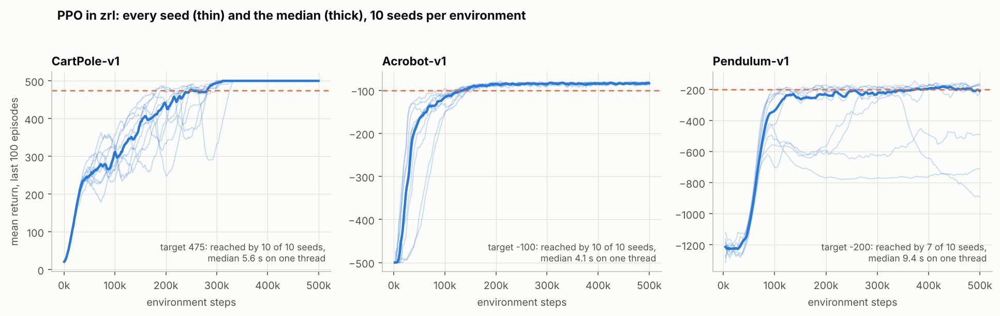
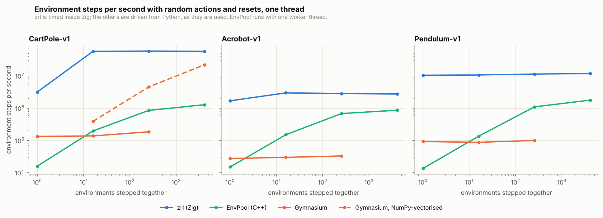
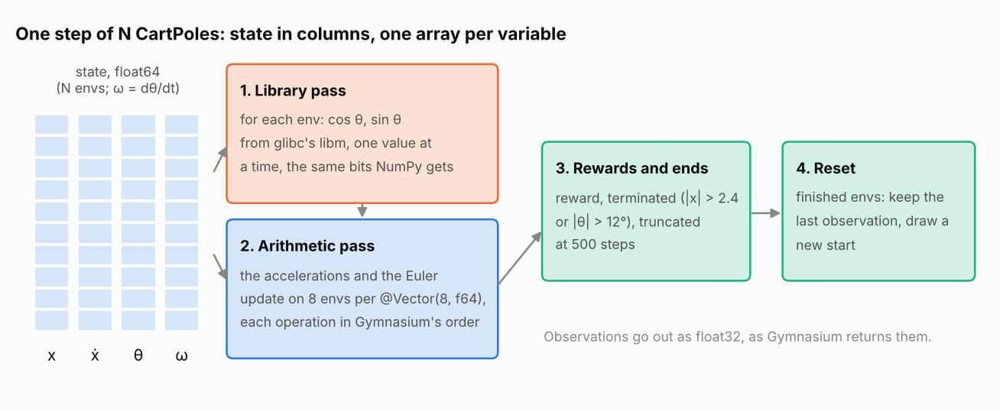

# zig-rl-envs

Gymnasium's CartPole, Pendulum and Acrobot in Zig, many copies stepped at once, with results bit-identical to Gymnasium 1.4.0's. It also includes proximal policy optimization (PPO), written from scratch with a small neural network, its gradient and the Adam optimizer, which solves all three.

Each environment keeps its state as one array per variable. A step does the C library calls (sine, cosine, power) one environment at a time, then the arithmetic on eight environments per `@Vector(8, f64)`, in exactly the order and precision Gymnasium uses. On one thread it steps 57 million CartPoles per second, 2.6 times as many as Gymnasium's own NumPy-vectorised CartPole.



## Results

All timings are from one 2-vCPU cloud VM (Intel Xeon, 2.3 GHz), with Gymnasium 1.4.0, NumPy 2.5.3 and glibc 2.39.

| Claim | Evidence | Grade |
|---|---|---|
| Bit-identical to Gymnasium 1.4.0 | 686,779 steps compared, including 23,355 terminations. The steps come from episodes started from Gymnasium's own seeded resets, with random actions, plus 500 full 500-step CartPole episodes under a balancing controller, and from 60,000 starting states spread over everything the dynamics can reach. Every float32 observation, float64 reward and termination flag matched | proven by script; CI repeats a tenth of it |
| Faster than Gymnasium's own vectorised CartPole | 57 million steps per second at 4,096 environments, against 22 million for Gymnasium's NumPy-vectorised CartPole. zrl reaches 57 million from 16 environments up | measured, one machine |
| Faster than EnvPool on one thread | At 4,096 environments: CartPole 45 times, Pendulum 6.7 times, Acrobot 3.2 times EnvPool 1.2.8's steps per second with one worker thread | measured, one machine |
| Faster than Gymnasium's environments | One environment in a Python loop: zrl takes 24 (CartPole), 62 (Acrobot) and 113 (Pendulum) times as many steps per second | measured, one machine |
| PPO solves CartPole and Acrobot every time | 10 of 10 seeds each. CartPole: the last 100 training episodes averaged 475 after a median of 237,000 steps and 5.6 s (4.4 to 6.8 s), and every final policy scores the maximum, 500, over 100 new episodes. Acrobot: −100 after a median of 125,000 steps and 4.1 s, and the final policies average −80 to −85 | measured, one machine |
| PPO usually solves Pendulum | 7 of 10 seeds reached −200 (median 9.4 s). Six of the ten final policies average better than −200 (−163 to −188), one −209, and three collapsed (−390, −720 and −883). For comparison, the RL Zoo's published PPO agent for Pendulum, which uses state-dependent exploration, averages −230 ± 142 | measured |
| Training is fast | Including all learning, PPO runs at 43,000 (CartPole), 31,000 (Acrobot) and 18,000 (Pendulum) environment steps per second on one thread | measured, one machine |
| Training is reproducible | A seed gives the same results, to the last printed digit of every return, on the two different VMs these runs used (24 runs compared). CI checks it on CartPole | proven (runs in CI) |
| The gradients are right | The network's hand-written backward pass agrees with central differences | proven by unit test |

The speed comparison is not like for like. zrl is timed inside Zig, with its actions drawn beforehand. The others are driven from Python, as they are normally used, so each step includes a Python call; EnvPool is designed to spread environments over many cores, and here it had one. zrl has no Python bindings, so it cannot yet stand in for them in Python training code.



## How it works



### Environments

`src/cartpole.zig`, `src/pendulum.zig` and `src/acrobot.zig` each define the dynamics twice: once for a single environment, as the reference, and once for a batch. A unit test checks that the two agree bit for bit. In the batch, each state variable is an array padded to a multiple of 8 environments. A step runs in two passes:

1. **Library calls**, one environment at a time: cos and sin of the angles, and the squares that Gymnasium writes as `x**2` (see below).
2. **Arithmetic**, eight environments per `@Vector(8, f64)` operation. The arithmetic is written in the same order as Gymnasium's Python, so every intermediate value is rounded at the same point.

Acrobot is the heaviest: one step is a fourth-order Runge–Kutta step, so the two passes run four times, with seven library calls per environment each time.

A vector environment (`src/batch.zig`) wraps a batch. It counts steps, truncates episodes at Gymnasium's time limits (500, 200 and 500 steps), and resets a finished environment in the same step, keeping its last observation for the learner. Starting states are drawn from Gymnasium's distributions, but with Zig's xoshiro256++ generator rather than NumPy's PCG64, so the same seed gives different episodes.

### Bit-identical to Gymnasium

Three things had to match, and two of them were last-bit traps:

- **Which sine.** NumPy's float64 sin and cos return the same bits as glibc's (the parity script checks 400,000 values). Zig, though, links its own compiler-rt `sin` and `cos` even when the C library is linked, and these differ from glibc's in the last bit for some inputs. zrl therefore calls glibc's `sinf64` and `cosf64`, aliases that glibc exports for the same functions, which compiler-rt does not define.
- **Squares.** NumPy computes `x**2` on a scalar with `pow(x, 2)`, and glibc's `pow` differs from `x * x` in the last bit for about one input in a thousand (267 of 300,000 tested). Gymnasium writes `**2` in Pendulum's cost and in Acrobot's dynamics, so zrl calls `pow` there too. CartPole uses `np.square`, which is `x * x`.
- **Precision.** Pendulum's torque arrives as float32, and NumPy keeps products of a float32 with a Python float in float32, so the torque's terms are computed in float32 and the rest in float64. Acrobot draws its starting state in float32 and then integrates in float64.

### PPO

`src/ppo.zig` follows CleanRL's `ppo.py` and `ppo_continuous_action.py`, as described in "The 37 implementation details of proximal policy optimization" (Huang et al., 2022):

- separate actor and critic networks, each with two hidden layers of 64 tanh units, and orthogonal initialisation;
- a categorical policy for CartPole and Acrobot. Pendulum uses a Gaussian policy whose log standard deviation does not depend on the state;
- generalised advantage estimates, normalised per minibatch;
- the clipped surrogate objective and a clipped value loss;
- one Adam optimizer with ε = 10⁻⁵, gradients clipped to a joint norm of 0.5, and a learning rate annealed linearly to zero.

One difference: when the time limit cuts an episode off, as it always does in Pendulum, the last reward gets γ times the critic's value of the last observation added, rather than being treated as the end of the task.

The network's forward and backward passes are written out by hand (`src/nn.zig`); a unit test checks the gradient against central differences. Training runs on one thread.

| Setting | CartPole | Acrobot | Pendulum |
|---|---|---|---|
| Environments × steps per rollout | 4 × 128 | 4 × 128 | 4 × 1024 |
| Steps in all | 500,000 | 500,000 | 500,000 |
| Learning rate (annealed) | 2.5×10⁻⁴ | 2.5×10⁻⁴ | 10⁻³ |
| γ, GAE λ | 0.99, 0.95 | 0.99, 0.95 | 0.9, 0.95 |
| Epochs × minibatches per rollout | 4 × 4 | 4 × 4 | 10 × 64 |
| Entropy coefficient | 0.01 | 0.01 | 0 |
| Observation and reward normalisation | no | no | yes |

CartPole and Acrobot use CleanRL's `ppo.py` defaults. Pendulum uses the RL Baselines3 Zoo's PPO settings for it (4 × 1024 steps per rollout, 10 epochs of minibatches of 64, learning rate 10⁻³, γ = 0.9), with three changes: no state-dependent exploration, CleanRL's normalisation of observations and rewards, and a learning rate annealed over 500,000 steps instead of a constant one over 100,000. In every case the clip range is 0.2 and the value-loss coefficient 0.5.

## Limitations

- Bit-identity holds on Linux with glibc, because it relies on NumPy and zrl calling the same libm. It was tested with glibc 2.39 and NumPy 2.5.3. Elsewhere zrl uses Zig's own math and drifts in the last bits.
- Starting states follow Gymnasium's distributions but not its random stream, so a seed does not reproduce Gymnasium's episodes. The parity checks set the starting states explicitly.
- Three environments, no rendering, and no Python bindings.
- PPO runs on one thread with small networks. On Pendulum, 3 of 10 seeds failed.
- PPO's speed was not compared with PyTorch implementations such as CleanRL's: PyTorch could not be installed on this machine.
- All timings come from one machine.

## Reproduce

Needs Zig 0.17.1 on Linux with glibc. The scripts need Python with numpy and gymnasium 1.4.0; `bench_envs.py` also uses EnvPool 1.2.8 if it is installed.

```sh
zig build test                     # unit tests
zig build -Doptimize=ReleaseFast
python3 scripts/ci.py              # what CI runs: parity on a tenth of the sequences, and PPO on CartPole
python3 scripts/parity.py          # full parity check (docs/data/parity.json)
python3 scripts/bench_envs.py      # steps per second (docs/data/bench_envs.json)
python3 scripts/bench_ppo.py       # PPO over 10 seeds (docs/data/bench_ppo.json)
python3 scripts/figures.py
```

To train:

```sh
./zig-out/bin/zrl train --env cartpole --seed 1 --log curve.csv
./zig-out/bin/zrl train --env pendulum --seed 1 --total_steps 300000 --lr 0.0005
```

Every field of the `Config` struct in `src/ppo.zig` can be set this way.

## License

Copyright (c) 2026 Ankit Pawar. All Rights Reserved.

This repository is public so that the work can be read and evaluated, but it is not open source. Using, copying, modifying, redistributing or commercially exploiting any part of it requires prior written permission. This does not affect what applicable law allows without permission, or viewing and forking the repository on GitHub under GitHub's Terms of Service. The full terms are in [LICENSE](LICENSE).

For licensing or collaboration, email ankitpawar0007x@gmail.com or visit [ankitinorbit.com](https://ankitinorbit.com).
